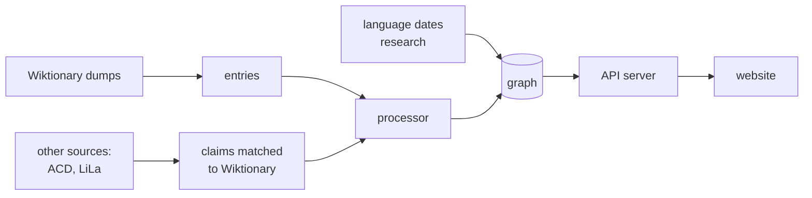

# [wety](https://www.wety.org/)

wety (for *Wiktionary etymologies*) draws the history of words as trees. Look up a
word in any language and see:

- **Etymology:** where it came from, back through its ancestors;
- **Descendants:** the words that came from it, in every language;
- **Cognates:** its relatives, the descendants of an ancestor it shares with them.

The trees come from the etymology sections of [English Wiktionary](https://en.wiktionary.org/):
about 10 million words in 6,000 languages. wety adds what other scholarly sources say
about the same words, where they cover them (so far the
[Austronesian Comparative Dictionary](https://acd.clld.org/) and de Vaan's Latin
etymological dictionary through [LiLa](https://lila-erc.eu/)), and shows when each
language was spoken, with the published sources for each date.

## How it works



1. **The entries extractor** (Rust) reads one month's dumps of Wiktionary (the rendered
   pages and their wikitext) and writes every entry as structured data: its etymology's
   prose with each template and footnote in place, its senses, its descendants.
2. **The processor** (Rust) turns every entry's etymology into links between words:
   inherited from, borrowed from, derived from, compounded of. It resolves which page and
   which etymology each mention means, and writes one graph file.
3. **Other sources** (Python) are converted into the same form, matched to
   Wiktionary's words, and built into the graph alongside Wiktionary's own claims.
   Where sources disagree, the graph keeps both and says which reading is shown.
4. **Language dates** come from a research registry of published sources: for each
   language, a period, how it was dated, and citations.
5. **The API server** (Rust) loads the graph into memory and answers the website's
   questions: a word's tree, its details, search.
6. **The website** (SolidJS) draws the trees.

Each step that produces data is a *workflow* with recorded inputs and outputs, so a
graph can be traced back to exactly what it was built from.

## What is where

| Directory | What it holds |
| --- | --- |
| [`crates/wiktionary-entries`](crates/wiktionary-entries) | Reads Wiktionary's dumps into wety's entries |
| [`crates/core`](crates/core) | The graph's data structures, shared by the processor and the server |
| [`crates/processor`](crates/processor) | Builds the graph from the entries and the other sources |
| [`crates/server`](crates/server) | The API behind api.wety.org |
| [`client/`](client/README.md) | The website, wety.org |
| [`packages/etymology`](packages/etymology/README.md) | Other etymological sources: converters, the claims schema, matching to Wiktionary |
| [`packages/dating`](packages/dating/README.md) | The research registry of language dates |
| [`packages/catalogs`](packages/catalogs/README.md) | Links between Wiktionary's language codes and other catalogs (Glottolog, ISO 639, Wikidata) |
| `packages/source_tools`, `packages/workflow_tools` | Downloading sources; running workflows and keeping their records (`wety-data`) |
| [`workflows/`](workflows) | One definition per data-producing step |
| [`data/`](docs/architecture/provenance.md) | Research data. Git holds only what the site is built from; the rest is a private, backed-up store |
| [`deploy/`](deploy/README.md) | How wety.org and its API are deployed |
| [`docs/`](docs) | [Building and serving the graph](docs/graph.md), [repository layout](docs/architecture/layout.md), [where data comes from and how it is kept](docs/architecture/provenance.md) |

## Running it

You need Rust (the version is pinned in `rust-toolchain.toml`), Python 3.12+ with
[uv](https://docs.astral.sh/uv/), and Node.js for the website.

Run the API server, then the website against it:

```sh
cargo run --locked --release --bin server        # http://127.0.0.1:3000
cd client && npm install && npm run dev           # http://127.0.0.1:8000
```

The server needs a built graph. Building one takes the research data (or Wiktionary
dumps of your own) and from half an hour to several hours:
[building and serving the graph](docs/graph.md). A fresh clone gets the research data
from the store with `uv run --frozen wety-data store restore` (access required; see
[provenance](docs/architecture/provenance.md#setting-up-the-store)).

Tests:

```sh
uv sync --frozen
cargo test --locked -p wety-core --lib
cargo test --locked -p wety-wiktionary-entries
cargo check --locked --workspace
uv run --frozen python -m unittest discover -s packages/etymology/tests
uv run --frozen python -m unittest discover -s packages/dating/tests
uv run --frozen python -m unittest discover -s packages/catalogs/tests
uv run --frozen python -m unittest discover -s packages/workflow_tools/tests
uv run --frozen python -m unittest discover -s packages/source_tools/tests
```

## Contributing

wety reads Wiktionary by rule, so some links are wrong or missing. Corrections to an
etymology belong on Wiktionary, where they reach wety with its next update. Problems
with wety itself are welcome as [issues](https://github.com/jmviz/wety/issues).

Work on wety is mostly done with AI coding agents; their instructions are in
[AGENTS.md](AGENTS.md).

## Licence

The code is under the [MIT licence](LICENSE.md). Wiktionary's content is under
[CC BY-SA 4.0](https://creativecommons.org/licenses/by-sa/4.0/); the other sources keep
their own licences, listed on [wety.org/about](https://www.wety.org/about).
